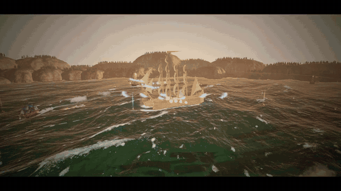

# Broadside

Online PvP age-of-sail ship battles with over-the-top physics: FFT ocean swell you can jump off,
360s in the air, cannonball arcs, power-up crates and an island-ringed arena.

**[Watch the full trailer (68 s)](https://github.com/Ferozaffs/Broadside/releases/download/v0.9.0/Broadside_v0.9.0_trailer.mp4)**

Built with [raylib](https://www.raylib.com/) and [ENet](http://enet.bespin.org/). The ocean is based on
[GarrettGunnell/Water](https://github.com/GarrettGunnell/Water).

## Playing

Download the latest zip from [Releases](../../releases), unzip it anywhere and run `broadside.exe`
(Windows, needs an OpenGL 4.3 GPU).

- **Practice**: play against bots.
- **Host**: the game asks your router to open **UDP port 27615** (UPnP) and shows the address friends should
  type at the top left (**F2** copies it). If the router has UPnP switched off, the game says so: switch it on in
  the router's settings, or forward UDP 27615 to your PC by hand. Allow `broadside.exe` through Windows Firewall
  when asked. Friends on the same network use the "same network" address.
- **Join**: type the host's IP address.

Everyone must run the same version.

| Key | Action |
| --- | --- |
| W / S | Ahead / astern |
| A / D | Rudder |
| Mouse | Aim (cannons follow the camera) |
| Left mouse | Fire broadside |
| Right mouse | Zoom (your own ship turns see-through) |
| Mouse wheel | Camera distance; roll all the way in to stand on the quarterdeck |
| V | Deck view on / off |
| M | Sound on / off |
| 1 / 2 / 3 | Next ship: cutter / frigate / ship of the line |
| Shift | Dash: a hard shove ahead, also in the air (skills on, 8 s cooldown) |
| E | Grappling hook on the ship under the reticle (150 m), E again to cut it (skills on, 12 s cooldown) |
| Tab | Scores |
| F1 | Hide help |

Sail through the floating crates for 15-30 s power-ups: **Rapid Reload**, **Triple Shot** and **Fair Wind**.

### Ships

Pick your ship in the menu; while you wait to respawn (or between rounds) press **1 / 2 / 3** to sail something
else next time.

| | Cutter | Frigate | Ship of the Line |
| --- | --- | --- | --- |
| Hull | 55 | 100 | 160 |
| Top speed | 36 m/s | 30 m/s | 24 m/s |
| Guns a side | 3 light, quick reload, swing 40 deg | 4, swing 34 deg | 6 heavy on two decks, slow reload, swing 26 deg |
| Special | bow chaser: one gun that fires forward | the all-rounder | lands like a hammer |

A cutter flies off every swell; a ship of the line barely leaves the water but out-guns a frigate. **Raking fire**:
a shot that runs along a ship's length (in at the bow or stern) does extra damage, more the longer the deck - so get
off a big ship's beam and onto its ends.

With Fleets, every captain's escorts are **gunboats**: half a frigate's length, 35 hull, two light guns a side.
They are escorts only, not a ship you can pick.

### Game modes

The host picks the game in the menu:

- **Free-for-all**: everyone against everyone. First to 12 sinkings.
- **Teams**: red against blue. No friendly fire; each side has a home harbour. First side to 20 sinkings.
- **Pirate**: one treasure chest surfaces somewhere out on the bay and everyone races for it. Whoever hauls it
  aboard turns pirate (black sails, a slightly tougher hull and a faster reload, but much slower, no Fair Wind and
  no repairs) and has to sail it to the harbour flying the black flag - always far away, and a different one for
  every treasure - and hold it for 10 seconds to unload, while everyone else hunts them. Sink the carrier and the
  treasure goes over the side for anyone to grab. First to 5 banked.

Rounds last 8 minutes or until someone reaches the score limit. Then the results: the winner, the standings and
the awards (Admiral of the Fleet, Master Gunner, Flying Dutchman, Spin Doctor, Treasure Hunter, Unsinkable, and
Landlubber for the captain who found the most rocks), and 18 seconds later a fresh round starts.

**Host options** (menu, below the game settings):

- **Ships allowed**: which of cutter / frigate / ship of the line players may pick. Bots keep to them too.
- **Camera**: Free, or Deck to make everyone play from the quarterdeck (first person).
- **Skills**: Dash (Shift) and grappling hook (E). A hooked line reels the two ships together for 7 seconds; the
  pull is shared by weight, so a cutter that hooks a ship of the line is the one that gets dragged. Once it's on, the
  line holds until its time is up (the ship holding it can let go early with E). Bots hunting a treasure carrier use both.
  The hook also bites on rock: put the reticle on a cliff or a sea stack within 150 m ("E HOOK ROCK") and the line
  hauls your own ship in towards it.
- **Arena**: Isles (the open bay inside the island ring), or Maelstrom: a whirlpool that fills the bay, 1.2 km
  across, falling away into a funnel 75 m deep. The outer half is a carousel: the water carries everyone round and
  you can fight in it or sail straight across it. Further in, the pull gets stronger the deeper you go, until it
  runs faster than you can sail: a ship of the line can't get out from inside ~100 m, a frigate ~80 m, a cutter
  ~60 m (a dash buys a little more). The eye pulls a hull under and grinds it up. Six sea stacks stand round the deep
  part, 180-300 m out: with skills on, grapple one and haul yourself out from where sailing alone can't (the swirl
  carries you past one sooner or later). Mind them, too: the current will happily smash you into one. Whoever last
  hit a ship, or had a line on it, gets the kill when the maelstrom takes it.

**Crew** (pick "You sail as: Crew" in the menu, or `--crew`): instead of a ship of your own you sign on aboard
someone else's, as a sailor on deck in first person. You join the captain who needs hands most, a human or a bot,
and if nobody is sailing a bot takes the helm for you, so it works alone too.

- **W A S D** walk the deck (Shift runs), up the quarterdeck ladders and along the gangways; the deck carries you.
- **E** at a gun works it: you aim it yourself (it's laid on whatever is under the reticle) and **left mouse**
  fires it. A gun you're working has its own reload. Guns nobody works are manned by the ship's own gun crew and
  fire with the captain's broadside as before.
- **F** (hold) at a shot hole patches it. On a ship with human crew every hit leaves a hole that slowly lets water
  in (0.35 hull a second each) until someone patches it, which wins back half of what that hit cost.
- Hold on: when she goes over on her beam ends, or slams down from a big jump, you can go over the side. Swim back
  (the current carries you) and press **E** at the hull to climb aboard, or wait and they'll haul you in.
- **E** at the wheel takes the helm (she turns 15% quicker with a helmsman), at the pin rail by the mainmast it
  tends the sails (6% more speed).
- The captain gives orders with **Z** (man the port guns), **X** (starboard guns) and **C** (patch the holes); bot
  captains give them too.
- **Esc** lets you change ship, take a ship of your own, or (as a captain) sign on as crew, without leaving the game.
  The scoreboard lists the crew under their captain with their own hits, sinkings and patches.

The ship of the line has its own model now, and the sailors on deck are animated pirates in three outfits.

**Fleets** (on top of any mode): every captain gets three AI escort ships that sail in formation and fight
alongside. Ships you lose stay lost until you are sunk yourself (you come back with a fresh fleet) or until you
sail into a friendly harbour, which also repairs your hull.

Aiming: the cannonballs land where the reticle points (on an enemy hull, the sea or the rocks). The guns swing
about 34 degrees either side of the beam; the dashed lines on the water show how far. When the reticle is outside
them the HUD says "GUNS CAN'T BEAR" and which way to steer.

## Building

Windows with Visual Studio 2026 (C++ workload): run `build.bat`. CMake fetches raylib 5.5 and ENet 1.3.18.
The game is `build/broadside.exe`.

`broadside.exe --simtest` runs the headless physics checks and a bot match in every game mode.
Hosting from the command line: `broadside.exe --host --mode teams --fleets --bots 3`
(also `--classes cutter,frigate`, `--deck-only`, `--skills`, `--arena maelstrom`, `--time night`, `--weather storm`).
Join as crew: `broadside.exe --join <address> --crew`, or practise as crew with `--practice --bots 3 --crew`.

### Ship model

The galleon model is a third-party asset ("Age of sail Blender ship" by NelloF, Fab Standard License) and
is **not** in this repository. Without it the game falls back to a built-in procedural hull. To use your own
licensed copy, put the `.glb` and `ship.cfg` in `assets/ship/`. Release zips carry it scrambled as
`ship.pak` (`tools/pack_ship.py`) so the model is not handed out on its own.

Levels of detail come from `tools/blend_to_game_ship.py` (Blender, `-- out_dir hull_length detail name`):
`ship_hi.glb` (detail 4, ~370k triangles, your own ship close up and on deck), `ship.glb` (detail 1, ~150k) and
`ship_lo.glb` (detail 0.25, ~56k, distant ships and shadows). The extra levels are optional and share the
standard model's textures.

## Credits

See [THIRD_PARTY_NOTICES.md](THIRD_PARTY_NOTICES.md).
